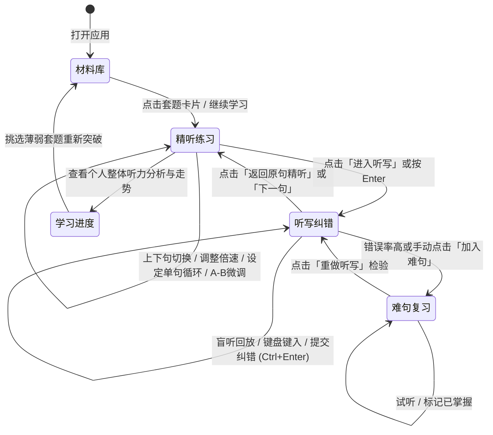

# ListeningLab (CET-6 六级听力精听训练系统) 设计规范与状态模型

> **版本**：v1.0 (Mockup & Spec)  
> **面向**：产品审查（Captain）、前端开发团队、测试团队  
> **设计基准**：桌面优先（1280px 标准宽，1024px 自适应兼容），纯本地离线单文件架构

---

## 1. 产品定位与设计理念

### 1.1 背景与痛点
大学英语六级（CET-6）听力总分占 35%（248.5分），是绝大多数备考学生通过或冲击高分（500+）的关键瓶颈。
传统听力备考常见痛点包括：
1. **盲目泛听**：一遍过或整篇放，抓不住连读、弱读、爆破等语音现象；
2. **缺乏颗粒度**：播放器跳回特定句子极其繁琐，无法聚焦于攻克单一句子；
3. **假性理解**：对着原文听以为听懂了，一旦遮住原文提笔听写就漏洞百出；
4. **错题流失**：听不懂的句子没有结构化沉淀，考前无法高效针对性复盘。

### 1.2 核心训练闭环
ListeningLab 提出 **「五步精听闭环」**：
$$\text{材料库选定} \longrightarrow \text{逐句盲听与反复精听} \longrightarrow \text{词级听写与智能纠错} \longrightarrow \text{生词难句收藏} \longrightarrow \text{间隔复现与复习检验}$$

### 1.3 界面设计原则
- **认知减负（Focus-First）**：训练区大字展示、低干扰背景，避免花哨元素分散听力注意力。
- **键盘驱动（Keyboard-Driven）**：听写与反复回放属于高频操作，核心操作（播放/暂停、复读、上下句、遮罩、交卷）支持全局快捷键，双手无需频繁离开键盘。
- **严谨反馈（Punctual & Visual Feedback）**：听写纠错采用高对比度词级 Diff 标记（正确、错词、漏写、多写），让学生一眼看清语音漏洞。
- **断网无损（Offline-Ready）**：界面及功能不依赖外部 CDN、外链字体及图片，纯本地运行，适应自习室、网络受限或考前突击环境。

---

## 2. 页面布局与架构解析

系统由顶部导航与快捷状态栏、主体功能视窗以及全局辅助模态框组成。

### 2.1 六大核心页面设计理由

```
+-----------------------------------------------------------------------------------+
|  [Logo] ListeningLab 六级精听   [材料库] [精听练习] [听写纠错] [难句复习] [学习进度] [设置] | [套题指示器] [主题切换] [快捷键] |
+-----------------------------------------------------------------------------------+
|                                                                                   |
|                                主 工作 区 域 (Main Workspace)                      |
|                                                                                   |
+-----------------------------------------------------------------------------------+
|                    底部悬浮/固定播控条 (Audio Dock / Controller)                   |
+-----------------------------------------------------------------------------------+
```

#### 页面 1：材料库 (Material Library)
- **布局理由**：采用「顶部概览 KPI + 多维筛选搜索栏 + 响应式网格卡片」结构。
- **核心要素**：
  - 内置 10 套近五年 CET-6 真题（2022~2024），展示年份、套号、包含三大 Section 结构、总句子数、完成进度条、听写正确率指标。
  - 本地导入入口：支持考生导入自己的 MP3/WAV 音频以及 SRT/VTT/LRC 字幕文件，打破真题数量限制。
  - 快捷操作：支持快速筛选「全部/学习中/已完成/未开始」、按年份筛选，卡片悬浮即显示「继续练习」或「重新开始」。

#### 页面 2：精听练习主界面 (Intensive Practice)
- **布局理由**：采用「左侧句子流抽屉/侧栏 + 右侧专注精听主工作区」的双栏自适应布局。
- **核心要素**：
  - **句子流列表**：每句带有序号、时间戳、状态指示（未听/已听/已收藏/听写得分），支持快速跳转当前句。
  - **大字原文卡片**：
    - 支持「显示原文」、「模糊遮罩（防作弊但可看轮廓）」、「完全隐藏」三种模式。
    - 附带重点词汇高亮、连读标记与中文译文折叠面板。
  - **精听播控台**：
    - 动态波形与句段时间轴指示器。
    - **单句循环控制**：支持设置 1次、2次、3次、5次 或 无限循环。
    - **A-B 区间循环**：支持在单句内打点 A 与 B，反复推敲局部连读爆破弱音。
    - **变速引擎**：0.5x ~ 2.0x 梯度无级调节。
    - 快捷按钮：一键进入本句听写（Dictate）、一键收藏/取消收藏（Bookmark）。

#### 页面 3：听写纠错 (Dictation & Word Diff)
- **布局理由**：采用上下结构，上方为音频播放与盲听盲敲输入区，下方为提交后的对比分析看板。
- **核心要素**：
  - 输入框专为英文打字优化，支持自动聚焦、实时词数统计与快捷交卷（Ctrl+Enter）。
  - **词级 Diff 引擎**：
    - 绿色高亮（Green Badge）：完全拼写正确；
    - 红色删除线与对照（Red Badge + Strike）：词形错误、拼写偏差或用词不当；
    - 橙色虚线框（Amber Outline）：漏写词（Omission）；
    - 灰色删除线（Gray Strike）：多写词（Redundancy）。
  - 给出句级正确率（Accuracy Score %）与听写评级。
  - 一键操作：重听、重写、收藏至难句本、直达下一句。

#### 页面 4：难句复习 (Difficult Sentences Review)
- **布局理由**：卡片式错题本 + 复习队列沉浸模式。
- **核心要素**：
  - 难句列表：标明出处（如 2024年6月第1套 Section A）、错误次数、收藏时间、听写历史最高分。
  - 掌握状态切换：一键标记「已掌握」或「移入复习队列」。
  - 沉浸复习流：点击「开始连续复习」进入无干扰闪卡/回放抽测流。

#### 页面 5：学习进度 (Learning Analytics)
- **布局理由**：数据可视化看板，帮助学生建立备考反馈与信心。
- **核心要素**：
  - 核心指标卡：累计精听时长（小时）、完成句子总数、综合听写正确率、待复习难句数。
  - 趋势折线图（纯 SVG 矢量图表）：近 7 次训练的正确率波动走势。
  - 题型雷达/柱状分布：Section A（长对话）、Section B（听力篇章）、Section C（讲座演讲）的薄弱度对比。
  - 套题完成矩阵：每套题的精听与听写完成率明细。

#### 页面 6：系统设置 (Settings & Preferences)
- **布局理由**：清晰的表单分类配置，提供即时保存反馈。
- **核心要素**：
  - 播放设置：默认倍速、默认单句循环次数、原文默认显示方式、自动连播开关。
  - 听写设置：大小写宽容度、标点符号宽容度、自动播放次数。
  - 快捷键完整速查表（Cheatsheet）：列明所有键盘操作。
  - 数据管理：本地练习进度重置与模拟数据恢复。

---

## 3. 设计令牌系统 (Design Tokens)

为确保视觉统一并完全支持深色模式（Dark Mode），所有界面属性均绑定至语义化 CSS 变量（CSS Custom Properties）。所有文字与背景对比度经测试均达到 **WCAG 2.1 AA** 标准（正常文本 $\ge 4.5:1$，大文本 $\ge 3:1$）。

### 3.1 颜色系统 (Color Palette)

| 语义变量名 | 浅色模式值 (Light) | 深色模式值 (Dark) | 用途说明 |
| :--- | :--- | :--- | :--- |
| `--bg-app` | `#F8FAFC` (Slate 50) | `#0F172A` (Slate 900) | 全局底层应用背景 |
| `--bg-surface` | `#FFFFFF` | `#1E293B` (Slate 800) | 卡片、面板、弹窗等容器背景 |
| `--bg-surface-elevated`| `#F1F5F9` (Slate 100) | `#334155` (Slate 700) | 悬浮卡片、输入框底层、二级容器 |
| `--text-primary` | `#0F172A` (Slate 900) | `#F8FAFC` (Slate 50) | 正文主标题、核心英文大字、重要信息 |
| `--text-secondary` | `#475569` (Slate 600) | `#94A3B8` (Slate 400) | 次级说明、段落副标题、未激活状态 |
| `--text-muted` | `#94A3B8` (Slate 400) | `#64748B` (Slate 500) | 时间戳、弱提示、快捷键徽章 |
| `--primary` | `#4F46E5` (Indigo 600) | `#6366F1` (Indigo 500) | 核心品牌色、播放按钮、激活 Tab |
| `--primary-hover` | `#4338CA` (Indigo 700) | `#4F46E5` (Indigo 600) | 悬浮主色 |
| `--primary-light` | `#EEF2FF` (Indigo 50) | `rgba(99, 102, 241, 0.15)` | 浅色品牌衬底、当前句背景 |
| `--border-color` | `#E2E8F0` (Slate 200) | `#334155` (Slate 700) | 分割线、边框、卡片描边 |
| `--success` | `#10B981` (Emerald 500) | `#34D399` (Emerald 400) | 正确词、已掌握、100%完成率 |
| `--success-bg` | `#ECFDF5` (Emerald 50) | `rgba(16, 185, 129, 0.15)` | 正确词标签底色 |
| `--danger` | `#EF4444` (Rose 500) | `#F87171` (Rose 400) | 拼写错误、删除线、删除操作 |
| `--danger-bg` | `#FEF2F2` (Rose 50) | `rgba(239, 68, 68, 0.15)` | 错误词标签底色 |
| `--warning` | `#F59E0B` (Amber 500) | `#FBBF24` (Amber 400) | 漏写词、收藏星标、待复习 |
| `--warning-bg` | `#FFFBEB` (Amber 50) | `rgba(245, 158, 11, 0.15)` | 漏写词标签底色 |
| `--accent-extra` | `#64748B` (Slate 500) | `#94A3B8` (Slate 400) | 多写多余词（灰色删除线） |

### 3.2 字阶与版式 (Typography)
- **字体族**：优先调用系统无衬线抗锯齿字体族：
  `-apple-system, BlinkMacSystemFont, "Segoe UI", Roboto, "PingFang SC", "Hiragino Sans GB", "Microsoft YaHei", sans-serif`
- **等宽代码/快捷键字体**：`ui-monospace, SFMono-Regular, Menlo, Monaco, Consolas, monospace`
- **字号阶梯**：
  - `text-xs`: 12px (行高 16px) - 标签、快捷键键帽、时间戳
  - `text-sm`: 13px / 14px (行高 20px) - 次级列表文本、元数据
  - `text-base`: 15px / 16px (行高 24px) - 正文、中文译文、普通按钮
  - `text-lg`: 18px (行高 28px) - 小标题、卡片头部
  - `text-xl`: 20px (行高 28px) - 页面模块标题
  - `text-2xl`: 24px (行高 32px) - 听写核对大字原文、主统计数字
  - `text-3xl`: 28px / 32px (行高 40px) - 精听主句当前英文大字（确保自习或视力不疲劳）

### 3.3 间距与圆角 (Spacing & Radius)
- **间距模数**：4px / 8px / 12px / 16px / 20px / 24px / 32px / 48px
- **圆角规范**：
  - `radius-sm`: 4px (徽章、快捷键键帽)
  - `radius-md`: 8px (按钮、输入框、下拉框)
  - `radius-lg`: 12px (卡片、侧边抽屉、提示气泡)
  - `radius-xl`: 16px (主面板、大模态框)
  - `radius-full`: 9999px (圆形播控按钮、状态指示点)
- **阴影规范**：
  - `shadow-sm`: `0 1px 2px 0 rgba(0, 0, 0, 0.05)`
  - `shadow-md`: `0 4px 6px -1px rgba(0, 0, 0, 0.1), 0 2px 4px -1px rgba(0, 0, 0, 0.06)`
  - `shadow-lg`: `0 10px 15px -3px rgba(0, 0, 0, 0.1), 0 4px 6px -2px rgba(0, 0, 0, 0.05)`

---

## 4. 组件清单 (Component Catalog)

1. **AppHeader**：全局品牌 Logo、主导航选项卡、当前练习套题药丸胶囊、主题模式切换按钮（Dark/Light）、快捷键速查召唤按钮。
2. **AudioController**：核心播控组件，包含动态播放进度条（带当前句游标与已缓冲句段）、主播放/暂停、复读（Replay）、上一句/下一句、循环模式选择（1/2/3/5/$\infty$）、A-B 标记与清除、倍速切换下拉（0.5x~2.0x）。
3. **SentenceCard**：大字原句展示卡片，支持「清晰/模糊遮罩/隐藏」三种显示模式；包含收藏难句星标、进入听写动作触发、音标与难词点拨、译文展开折叠。
4. **SentenceListSidepanel**：句子抽屉列表，显示当前套题全部句子，标注序号、时间范围、已听状态、收藏状态、听写得分，支持点击瞬时定位。
5. **WordDiffViewer**：词级差异渲染器，将用户听写输入与标准原句对比，分色显示匹配项、拼写替换项、缺失项、冗余项，并计算准确率。
6. **SetCard**：真题套题卡片，展示年份、套号、包含小节（Section A/B/C）、总时长、练习进度百分比环、平均听写正确率指标。
7. **MetricCard**：统计指标卡，采用大数字 + 趋势标签 + 语义化矢量图表底纹。
8. **ReviewItemCard**：难句复习条目，展示句型、来源套题、错误频次、快速播放试听、单句重新听写、掌握标记。
9. **ModalDialog**：通用模态弹窗系统（用于本地素材导入、快捷键速查表、连续复习沉浸式弹窗）。
10. **ToastNotifier**：非模态轻量通知组件，用于提示「已加入难句本」、「设置已保存」、「导入成功」等状态。

---

## 5. 开发阶段页面状态模型 (Page State Model)

在后续前端工程化落地（如 Vue 3 / React / Svelte）时，可直接参考以下状态结构与数据模型：

### 5.1 数据模型（TypeScript 类型定义建议）

```typescript
// 1. 页面路由定义
export type PageId = 'library' | 'practice' | 'dictation' | 'review' | 'stats' | 'settings';

// 2. 六级听力套题
export interface ExamSet {
  id: string;               // 例: "cet6-2024-06-1"
  title: string;            // "2024年6月 六级听力真题 (第1套)"
  year: number;             // 2024
  month: number;            // 6
  setNumber: number;        // 1
  category: 'cet6-real' | 'custom-import';
  sectionTypes: ('Section A' | 'Section B' | 'Section C')[];
  totalDurationSec: number; // 1560 (26分钟)
  sentenceCount: number;    // 28
  completedSentences: number;
  averageAccuracy: number;  // 86.5
  sentences: Sentence[];
}

// 3. 单句数据
export interface Sentence {
  id: string;               // "s_202406_01_03"
  setId: string;
  index: number;            // 从 1 开始
  section: string;          // "Section A (长对话 1)"
  startTime: number;        // 秒数 45.2
  endTime: number;          // 秒数 52.8
  english: string;          // "Green roofs and permeable pavements can absorb significant amounts of precipitation."
  chinese: string;          // "屋顶绿化和透水路面可以在径流压垮排水系统之前吸收大量降水。"
  keyVocab?: { word: string; phonetics: string; definition: string }[];
  status: 'unread' | 'listened' | 'dictated';
  isBookmarked: boolean;
  dictationHistory?: DictationRecord[];
}

// 4. 听写记录与词级 Diff 结果
export interface DictationRecord {
  timestamp: number;
  userInput: string;
  accuracy: number;        // 0 ~ 100
  diffTokens: DiffToken[];
}

export type DiffType = 'correct' | 'wrong' | 'missing' | 'extra';

export interface DiffToken {
  type: DiffType;
  expected?: string;       // 正确词
  actual?: string;         // 用户写的词
}

// 5. 播控与精听引擎状态
export interface PlayerState {
  currentSetId: string;
  currentSentenceIndex: number;
  isPlaying: boolean;
  currentTime: number;
  duration: number;
  playbackRate: number;    // 0.5 ~ 2.0
  loopMode: 'off' | 'sentence' | 'ab';
  sentenceLoopCountTarget: number; // 1, 2, 3, 5, 999(无限)
  currentLoopIteration: number;
  abPointA: number | null;
  abPointB: number | null;
  transcriptVisibility: 'visible' | 'blur' | 'hidden';
}

// 6. 全局设置项
export interface UserSettings {
  defaultPlaybackRate: number;       // 1.0
  defaultLoopCount: number;          // 2
  defaultTranscriptVisibility: 'visible' | 'blur' | 'hidden';
  autoPlayNext: boolean;             // false
  caseSensitiveDictation: boolean;   // false
  ignorePunctuation: boolean;        // true
  theme: 'light' | 'dark';
}
```

### 5.2 核心算法逻辑：词级听写比对 (Myers/LCS Diff)

为实现词级精准纠错，听写模块在比对时执行以下流水线：
1. **标准化预处理（Tokenization & Normalization）**：
   - 提取单词 Token 序列；
   - 根据用户设置（`ignorePunctuation`、`caseSensitiveDictation`）决定是否转为小写及剔除逗号、句号、引号等符号；
2. **最长公共子序列（LCS）匹配**：
   - 将期望词序列 $E = [e_1, e_2, ..., e_n]$ 与用户实际输入词序列 $A = [a_1, a_2, ..., a_m]$ 进行比对；
   - 寻找公共词流，其余分支归纳为：
     - 若 $e_i$ 存在但 $A$ 中跳过 $\implies$ `missing`（漏写）；
     - 若 $a_j$ 存在但 $E$ 中无对应 $\implies$ `extra`（多写）；
     - 若相邻位置同时存在 $e_i$ 与 $a_j$ $\implies$ `wrong`（拼写替换/错误）；
     - 两者一致 $\implies$ `correct`（正确）。
3. **正确率核算公式**：
   $$\text{Accuracy} = \max\left(0, \frac{\text{Count}(\text{correct})}{\text{Count}(E)} \times 100\%\right)$$

### 5.3 交互链路驱动图 (Interaction Loop)



---

## 6. 无网络环境兼容性承诺与验收检查项

- [x] **0 外部资源请求**：无任何 `fonts.googleapis.com`、`cdnjs.cloudflare.com`、`jsdelivr.net` 等外部请求；
- [x] **纯内联矢量图标**：所有播放、设置、搜索、统计、星星图标均使用精美手写 SVG；
- [x] **内置拟真 Web Audio 引擎**：在无外置音频文件时，内置 Web Audio API 振荡波形与时间序列模拟器，提供真实的毫秒级播放、进度步进、波形起伏与多遍循环反馈；
- [x] **自包含状态机**：无需数据库，基于单页面内存对象（辅以标准浏览器 LocalStorage 降级保持）实现即开即用、随时重置。
